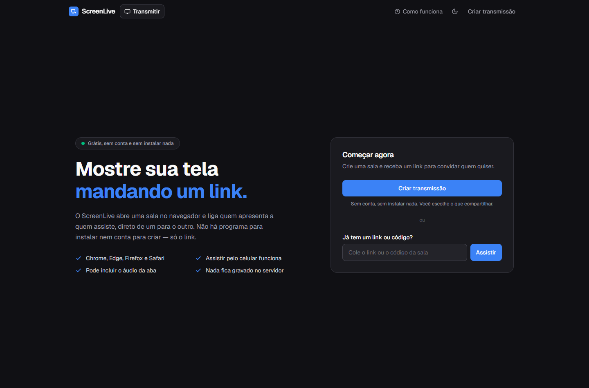
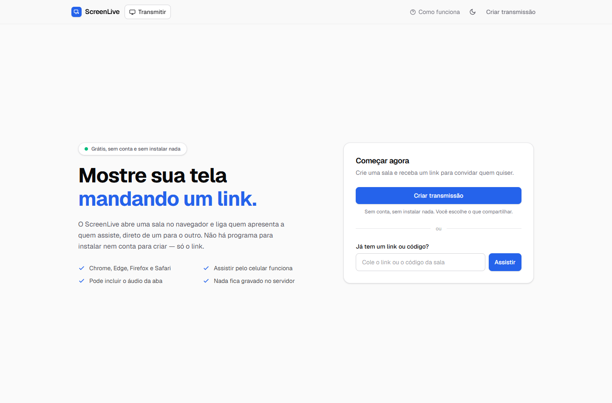
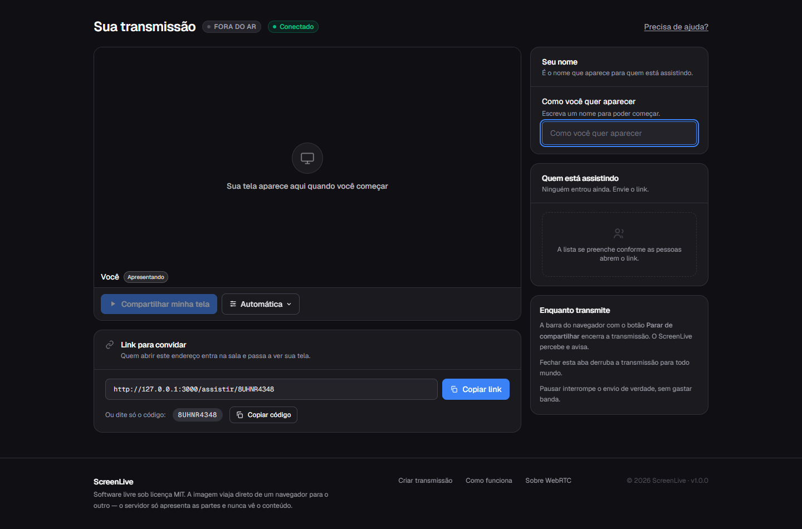
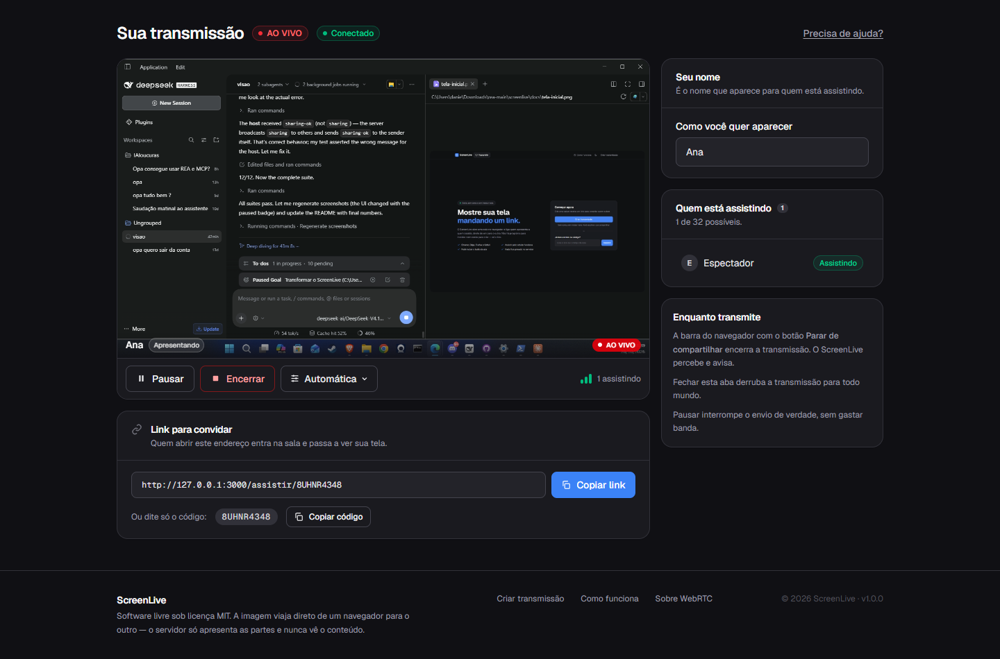
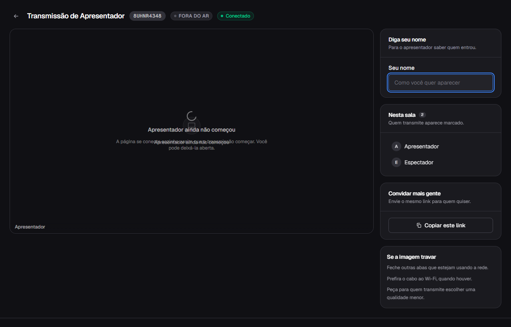
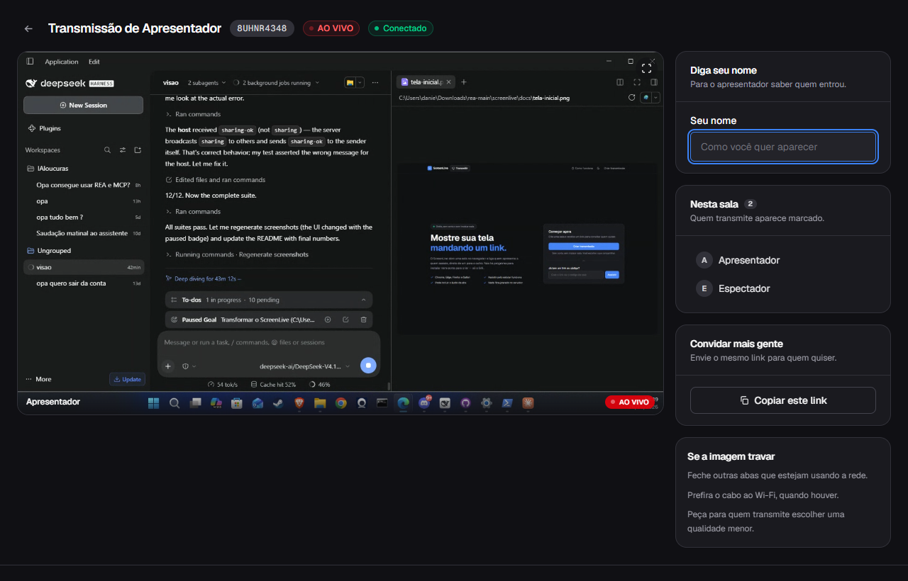
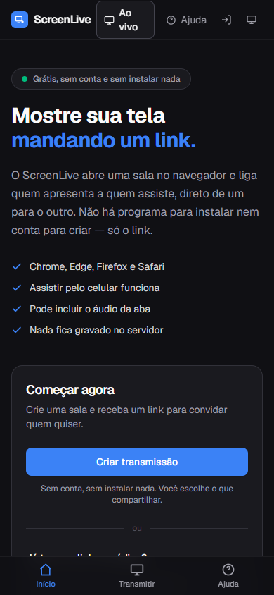
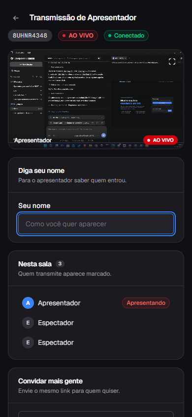
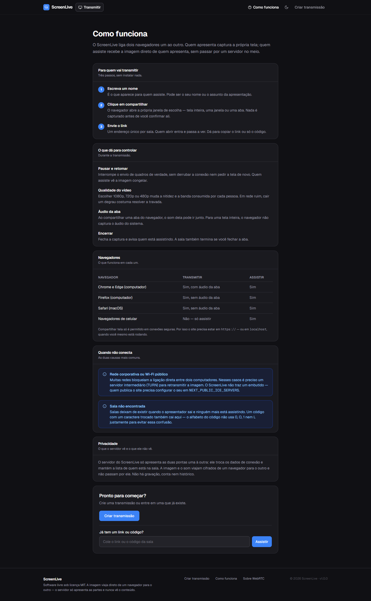

# DanielLive

Compartilhamento de tela pelo navegador em quatro passos: **criar a transmissão → copiar o
link → começar a compartilhar → a outra pessoa abre o link e assiste**. Sem instalar
programa, sem criar conta, sem configuração técnica.

A interface reaproveita a identidade visual do projeto de referência (tema escuro em
camadas, cabeçalho enxuto, cartões arredondados), mas **todo o código é original**: o
backend, a sinalização, o cliente WebRTC e as páginas foram escritos do zero neste
repositório. Ver [Licenças e origem](#licenças-e-origem).



---

## Índice

- [O que a aplicação faz](#o-que-a-aplicação-faz)
- [Como executar](#como-executar)
- [Aplicativo para Windows](#aplicativo-para-windows)
- [Arquitetura](#arquitetura)
- [Variáveis de ambiente](#variáveis-de-ambiente)
- [Configuração de STUN e TURN](#configuração-de-stun-e-turn)
- [Implantação](#implantação)
- [Testes](#testes)
- [Segurança e privacidade](#segurança-e-privacidade)
- [Limitações conhecidas](#limitações-conhecidas)
- [Licenças e origem](#licenças-e-origem)

---

## O que a aplicação faz

| Recurso | Estado |
|---|---|
| Criar sala com link único e difícil de adivinhar | ✅ |
| Copiar link (com alternativa para contexto não seguro) | ✅ |
| Captura de tela real via `getDisplayMedia` | ✅ |
| Escolha entre tela, janela ou aba (do navegador) | ✅ |
| Áudio da aba/sistema, quando o navegador oferece | ✅ |
| **Pausar e retomar sem derrubar a captura** | ✅ |
| **Qualidade do vídeo (automática, 1080p, 720p, 480p)** | ✅ |
| Transmissão para vários espectadores (mesh) | ✅ |
| Espectador entra pelo link sem conta | ✅ |
| Lista de participantes com quem transmite e estado da conexão | ✅ |
| Indicador de qualidade da conexão | ✅ |
| Detecção de encerramento pelo navegador | ✅ |
| Reconexão automática e recuperação de ICE | ✅ |
| Estados de erro explícitos (permissão negada, sem suporte, sala inexistente, sala cheia) | ✅ |
| Responsivo (desktop, tablet, celular) | ✅ |
| Tema claro/escuro/sistema | ✅ |
| Gravação da transmissão | ❌ fora do escopo |
| Chat de texto | ❌ fora do escopo |
| Câmera e microfone | ❌ fora do escopo |
| Contas de usuário | ❌ fora do escopo |
| SFU (salas muito grandes) | ❌ ver [Limitações](#limitações-conhecidas) |

### Controles de quem transmite

| Controle | O que faz |
|---|---|
| **Compartilhar minha tela** | Abre a escolha do navegador (tela, janela ou aba) e começa a transmitir |
| **Pausar / Retomar** | Interrompe o envio de quadros sem encerrar a captura. Quem assiste vê a imagem congelar; retomar é instantâneo e **não** pede a tela de novo |
| **Encerrar** | Fecha a captura e avisa quem está assistindo |
| **Qualidade do vídeo** | Automática, 1080p, 720p ou 480p. Vale para a próxima vez que compartilhar |
| **Áudio da aba** | Liga/desliga a captura de áudio (só funciona ao compartilhar uma aba) |

A pausa atua sobre o parâmetro `active` da codificação do `RTCRtpSender`, mantendo a
faixa anexada. As duas alternativas óbvias não servem: desligar a faixa
(`track.enabled`) faria o navegador enviar quadros pretos gastando a mesma banda; e
remover a faixa (`replaceTrack(null)`) descarta o estado do codificador, de modo que
ao devolvê-la o decodificador do outro lado espera por um quadro-chave que nunca
chega — a imagem fica congelada depois de retomar. Ambas foram testadas e descartadas
por medição, não por suposição.

### Telas

| Início (escuro) | Início (claro) |
|---|---|
|  |  |

| Transmitir — pronto | Anfitrião ao vivo |
|---|---|
|  |  |

| Espectador esperando | Espectador assistindo |
|---|---|
|  |  |

| Celular — início | Celular — assistindo |
|---|---|
|  |  |

| Como funciona |
|---|
|  |

---

## Como executar

### Requisitos

- **Node.js 22.19 ou superior** (os testes usam `--experimental-strip-types`, disponível a
  partir do 22.6, e `node --test` com glob, estável no 22).
- npm 10 ou superior.
- Para transmitir: um navegador com `getDisplayMedia` — Chrome, Edge, Firefox ou Safari
  atuais.

### Instalação

```bash
npm install
cp .env.example .env.local   # opcional em desenvolvimento
```

### Desenvolvimento

```bash
npm run dev
```

Sobe as duas partes ao mesmo tempo:

- **site** em http://localhost:3000
- **sinalização** em ws://localhost:8787 (saúde em http://localhost:8787/health)

Separadamente, se preferir:

```bash
npm run dev:web      # só o site
npm run dev:signal   # só a sinalização
```

### Produção

```bash
npm run build
npm start
```

> **Importante sobre `getDisplayMedia`:** os navegadores só permitem captura de tela em
> **contexto seguro** — `https://` ou `localhost`. Para testar de outro dispositivo da rede
> por IP (`http://192.168.x.x:3000`), a captura será bloqueada. Use um túnel HTTPS
> (`cloudflared tunnel`, `ngrok`) ou sirva atrás de um proxy com TLS.

---

## Aplicativo para Windows

O DanielLive também instala como aplicativo de desktop. **É a mesma interface e o mesmo
código** — o aplicativo sobe os dois servidores (interface e sinalização) localmente e abre
uma janela apontando para eles. Não existe uma segunda versão da interface para manter em
dia: site e aplicativo não podem divergir porque são o mesmo projeto.

### Por que Electron, e não Tauri

A decisão foi tomada pelo recurso que é o propósito do programa: **capturar a tela**.

| Critério | Electron | Tauri (WebView2) |
|---|---|---|
| Controle do seletor de captura | `setDisplayMediaRequestHandler` + `desktopCapturer` — o aplicativo decide a fonte | O WebView2 abre o seletor do sistema; não há como interceptá-lo |
| Automação do seletor em testes | Sim, pelas mesmas APIs | Não |
| Motor de renderização | Chromium próprio, igual em toda máquina | O WebView2 instalado na máquina (versões diferentes) |
| Tamanho do instalador | ~370 MB | ~10 MB |
| Toolchain | Nenhuma além do Node | Rust + MSVC + WiX |

O Tauri ganha com folga em tamanho, e foi por isso que ele foi considerado a sério. Mas um
aplicativo cuja função é compartilhar tela não pode depender de um seletor que ele não
controla: no Tauri, `getDisplayMedia` cai no diálogo do WebView2, sem como escolher a fonte
por código, e sem como testar isso automaticamente. Somar Rust e MSVC ao build também
adicionaria pontos de falha sem resolver o problema principal. Os ~360 MB extras são o preço
de a captura de tela ser previsível.

### Instaladores gerados

| Arquivo | Para quê |
|---|---|
| `dist-desktop/DanielLive-Setup-1.0.0.exe` | Instalador assistido (recomendado). Assistente em português, escolhe a pasta, cria atalhos na área de trabalho e no menu Iniciar, e registra a desinstalação em "Aplicativos instalados". |
| `dist-desktop/DanielLive-1.0.0.msi` | Para distribuição corporativa por GPO/Intune. |
| `dist-desktop/DanielLive-Portatil-1.0.0.exe` | Executa sem instalar. Útil para testar. |

Tamanhos medidos neste projeto: **MSI ≈ 395 MB**, **NSIS ≈ 406 MB** (payload `daniellive-1.0.0-x64.nsis.7z`), **portátil ≈ 264 MB**.
O volume vem do Chromium que o Electron embarca (o `DanielLive.exe` sozinho tem ~238 MB) — é
o preço de a captura de tela se comportar igual em qualquer máquina.

> **Aviso do SmartScreen:** os instaladores não são assinados digitalmente, então o Windows
> mostra "O Windows protegeu o computador" na primeira execução. É preciso clicar em
> **Mais informações → Executar assim mesmo**. Isso só desaparece comprando um certificado
> de assinatura de código (EV ou OV) — não é um defeito do instalador.

### Como gerar

```bash
npm run icone          # (re)gera build/icon.png e build/icon.ico
npm run desktop:build  # compila a interface e gera os três instaladores
```

**Na primeira vez, prefira o comando único**, que confere o ambiente antes de gastar dez
minutos de empacotamento e valida o resultado no fim:

```bash
npm run build:windows
```

Ele faz, em ordem: confere Node, dependências, Chrome, pastas e portas; gera o ícone; roda
lint, tipos e os testes unitários; compila o site; aplica a correção do NSIS; limpa
`dist-desktop/`; gera os instaladores; e por fim confere que cada arquivo existe, tem tamanho
plausível e que o instalador NSIS realmente contém o desinstalador. No fim imprime o **caminho
completo** de cada artefato. Se algo falhar, a mensagem diz o que fazer — inclusive como
consertar um `%TEMP%` inválido.

Para rodar em modo de desenvolvimento, sem empacotar:

```bash
npm run desktop        # abre a janela do Electron usando o código atual
```

### O mascote

O mascote oficial é o **pato de óculos**. Ele não vem no repositório: salve a arte em

```
public/branding/pato.png
```

e rode `npm run icone`. A partir daí o mascote aparece na página inicial e vira o ícone do
executável, do instalador e dos atalhos. Instruções detalhadas em
[`public/branding/LEIA-ME.md`](public/branding/LEIA-ME.md).

Três garantias que o código dá, independentemente da arte que você usar:

- **não distorce** — a imagem é encaixada por proporção (`contain`), então arte quadrada, alta
  ou larga entra inteira, com o que sobra transparente;
- **preserva a transparência** — o canal alfa passa direto, o que importa em 16 px, onde um
  fundo branco deixaria um quadrado feio na barra de tarefas;
- **não inventa substituto** — sem o arquivo, a interface mostra o glifo da marca (uma tela com
  um ponto de transmissão), nunca um desenho diferente no lugar do seu mascote.

### Redes sociais

Os endereços ficam em **`lib/marca.ts`**, em um único lugar:

```ts
export const REDES: Rede[] = [
  { id: "github", nome: "GitHub", url: "", usuario: "euodeene", confirmado: false },
  // ...
];
```

Preencha `url` e mude `confirmado` para `true`. Enquanto um endereço não estiver confirmado,
a interface **não cria link clicável**: ela lista a rede como "a confirmar". Isso é
deliberado — é melhor mostrar que falta preencher do que mandar alguém para um perfil errado
ou para um 404. Quando o último endereço for confirmado, o aviso some sozinho.

Os links confirmados abrem em nova aba com `rel="noopener noreferrer"` e têm rótulo acessível
dizendo o nome da rede e que o link é externo.

### Correção do instalador: "Error writing temporary file" e desinstalador ausente

Dois sintomas distintos foram investigados aqui, e vale separá-los porque têm causas
diferentes.

**1. "NSIS Error — Error writing temporary file" ao abrir o instalador.** A mensagem acusa o
`%TEMP%`, mas o instalador era encerrado antes de escrever qualquer coisa nele. O arquivo
entregue naquela ocasião estava corrompido: havia sido gerado com um ajuste experimental no
`electron-builder` que fazia a primeira passada ler o desinstalador de um instalador ainda pela
metade. Esse ajuste foi removido, e o instalador passou a ser gerado pelo fluxo normal.

**2. Instalador que instala mas não desinstala.** Esta era a falha real, e a causa é esta:

O `electron-builder` monta o NSIS em **duas passadas**. Na primeira ele compila um instalador
mínimo e o **executa**, para que ele escreva o desinstalador; na segunda compila o instalador
final já com o desinstalador embutido. Duas características tornam essa etapa frágil:

- a execução da primeira passada tem limite fixo de **120 segundos**
  (`app-builder-lib/out/vm/WineVm.js`);
- quando ela estoura, o `electron-builder` **não confere** se o desinstalador saiu —
  `NsisTarget.js` chama `signIf(uninstallerPath)` sem testar a existência do arquivo.

Numa máquina carregada, o resultado é um instalador de ~427 MB que instala o aplicativo
normalmente e **não tem desinstalador**. O tamanho engana: parece completo.

Como a correção exigiria alterar `node_modules` (recriado a cada `npm install`, e que já
corrompeu o projeto uma vez), quem trata isso é o `scripts/build-windows.mjs`. Ele reconhece o
resíduo pelo tamanho — ~300 KB contra ≥100 MB do instalador de verdade — limpa a pasta, tenta de
novo e, se ainda falhar, **para com um erro explícito** em vez de entregar o arquivo quebrado.

> **Sobre a suspeita da trava de instância única.** Chegou-se a atribuir o problema à macro
> `ALLOW_ONLY_ONE_INSTALLER_INSTANCE`, que chama `CreateMutex` antes de extrair. A suspeita era
> que ela tratasse uma falha da chamada como "já existe uma instância" e abortasse. **O teste
> desmentiu:** compilando um instalador que usa a macro real do `electron-builder`, ela passa e o
> processo sai com código **0**. O `Pop` que a macro usa captura o código de erro do `?e`, então
> `0` é sucesso e `183` é "já existe" — exatamente como o código original supõe. O template **não**
> é alterado por este projeto, e nenhuma verificação de segurança foi desligada: o UAC continua
> valendo, as permissões também.

> **Se o erro "Error writing temporary file" aparecer na sua máquina**, confira separadamente se o
> `%TEMP%` é válido — é um terceiro problema, independente dos dois acima:
>
> ```bat
> echo %TEMP%
> dir "%TEMP%"
> ```
>
> Se a pasta não existir ou não aceitar escrita, aponte para uma válida **nesta janela** e rode o
> build de novo:
>
> ```bat
> set TEMP=%LOCALAPPDATA%\Temp
> set TMP=%LOCALAPPDATA%\Temp
> mkdir "%LOCALAPPDATA%\Temp" 2>nul
> npm run build:windows
> ```

#### Como conferir se o seu instalador está completo

Não dá para saber lendo o arquivo: o desinstalador é gerado na hora da instalação, a partir de um
script que vive comprimido dentro do instalador. A verificação é instalar de verdade — o que
`npm run test:instalador` faz, em pastas temporárias e sem UAC:

```bat
npm run test:instalador
```

Ele instala, confere que o aplicativo e o desinstalador foram criados, confere o registro do
Windows e o atalho do Menu Iniciar, desinstala, confere que tudo sumiu e reinstala. Antes disso, o
`npm run build:windows` já avisa no fim se o instalador saiu com tamanho de resíduo.
> ```

### Sobre a primeira execução do instalador

O instalador **não é assinado digitalmente**, então o Windows mostra "O Windows protegeu o seu
PC" e é preciso clicar em **Mais informações → Executar assim mesmo**. Isso é esperado em
software livre sem certificado de assinatura de código, e não indica problema no arquivo.
Também **não** desative o SmartScreen nem o antivírus para contornar isso.

### O que o aplicativo faz por dentro

1. Escolhe duas portas livres em `127.0.0.1` (a partir de 3480) — portas fixas quebrariam
   quando a 3000 já estivesse em uso.
2. Sobe a sinalização (`server/index.mjs`) e a interface (`next start`) como processos
   filhos, usando o **próprio binário do Electron como runtime Node**. Assim o aplicativo
   não depende de haver um Node instalado na máquina do usuário.
3. Espera as duas responderem antes de abrir a janela, para não mostrar erro de conexão no
   primeiro segundo.
4. Informa ao cliente já compilado qual porta de sinalização usar, por um *preload* (ver
   "Variáveis `NEXT_PUBLIC_*`" abaixo).
5. Ao fechar, encerra os processos filhos — nenhum servidor fica órfão.

### Captura de tela no aplicativo

Dentro do Electron, o Chromium não abre o seletor nativo do sistema: quem escolhe a fonte é
o processo principal. O aplicativo traz o próprio seletor (`desktop/seletor.html`), com a
mesma identidade visual do site, listando telas e janelas com miniatura — e abas separadas
para cada tipo. Sem esse diálogo, `getDisplayMedia` falharia com `NotAllowedError` e a
função principal do aplicativo simplesmente não existiria.

### Variáveis `NEXT_PUBLIC_*` e o aplicativo

As variáveis `NEXT_PUBLIC_*` são gravadas pelo Next **dentro do bundle, em tempo de
compilação** — não são lidas em tempo de execução. Isso serve para o site, cujo endereço é
fixo, mas não para o aplicativo, que escolhe a porta de sinalização ao abrir.

Por isso, `lib/signaling.ts` consulta primeiro `window.__DANIELLIVE_SIGNAL_URL__`, que o
aplicativo define por *preload* antes de qualquer script da página rodar. A ordem importa: o
valor de execução é mais específico que o compilado, então ele tem precedência. No site essa
variável não existe e nada muda.

---

## Arquitetura

```
┌────────────────────┐        WebSocket (JSON)        ┌──────────────────────┐
│  Navegador A       │◄──────────────────────────────►│  Servidor de         │
│  (anfitrião)       │        só sinalização          │  sinalização         │
│                    │                                │  Node + ws           │
│  getDisplayMedia   │                                │  salas em memória    │
└─────────┬──────────┘                                └──────────┬───────────┘
          │                                                      │
          │            WebRTC (SRTP, ponta a ponta)              │
          │            a mídia NÃO passa pelo servidor           │
          ▼                                                      ▼
┌────────────────────┐                                ┌──────────────────────┐
│  Navegador B       │◄───────────────────────────────│  Navegador C         │
│  (espectador)      │        uma conexão por par     │  (espectador)        │
└────────────────────┘                                └──────────────────────┘
```

### Decisões e por quê

**Mesh, não SFU.** O anfitrião abre uma `RTCPeerConnection` por espectador. É a topologia
mais simples que funciona sem infraestrutura de mídia, e a mídia nunca toca o servidor —
o que mantém o custo de banda do servidor perto de zero e a privacidade alta. O custo é
que a banda de **upload do anfitrião** cresce com o público; por isso há um teto de 32
espectadores por sala. Salas maiores pedem um SFU (ver limitações).

**Estado em memória, sem banco.** O estado de uma transmissão ao vivo é efêmero: se o
processo reinicia, as conexões WebRTC morreram junto e um registro em banco só viraria
lixo. Salas vivem em um `Map` com expiração automática. A consequência é que a
sinalização **não escala horizontalmente** sozinha.

**O código da sala é a credencial.** Não há login: quem tem o link, entra. Por isso o
identificador tem 9 caracteres de um alfabeto de 31 (~2,6 × 10¹³ combinações), gerado com
`crypto.randomBytes` e amostragem por rejeição para não enviesar o alfabeto. Também não
usa `0/O/1/I/L`, para poder ser ditado em voz alta.

**Um único formato de mensagem, validado em um só lugar.** Toda mensagem que entra pelo
WebSocket passa por `server/protocol.mjs` antes de virar ação. Campos desconhecidos são
descartados na normalização, e o erro devolvido ao cliente é sempre um código curto — o
motivo detalhado fica no log do servidor.

### Estrutura de arquivos

```
app/
  page.tsx                      página inicial
  not-found.tsx                 endereço inexistente / código com formato inválido
  como-funciona/page.tsx        explicação e dúvidas comuns
  transmitir/
    page.tsx                    rota
    HostRoom.tsx                tela de quem apresenta (controles, qualidade, participantes)
  assistir/[code]/
    page.tsx                    valida o código no servidor (404 antes do WebSocket)
    WatchRoom.tsx               tela de quem assiste
  layout.tsx                    fontes, tema, cabeçalho, rodapé, barra inferior
  globals.css                   identidade visual (tokens, escala de camadas, animações)

lib/
  room-code.ts                  leitura/normalização/validação do código
  protocol.ts                   tipos das mensagens
  signaling.ts                  cliente WebSocket com reconexão
  webrtc.ts                     captura de tela + HostPeer/ViewerPeer
  ice.ts                        montagem da configuração STUN/TURN
  useHost.ts                    toda a lógica de quem apresenta (inclui pausa)
  useViewer.ts                  toda a lógica de quem assiste

server/
  index.mjs                     servidor WebSocket, roteamento das mensagens
  rooms.mjs                     registro de salas (puro, testável)
  protocol.mjs                  validação de mensagens
  ratelimit.mjs                 limite por conexão e por endereço

components/
  ui.tsx                        biblioteca de interface (botões, campos, diálogo, menu, selos)
  SiteHeader.tsx                cabeçalho fixo e translúcido
  SiteFooter.tsx                rodapé
  TabBar.tsx                    barra inferior de navegação (celular e tablet)
  ThemeToggle.tsx               tema claro/escuro/sistema
  ThemeScript.tsx               aplica o tema antes da primeira pintura
  HomeActions.tsx               criar transmissão, entrar por código, avisos de contexto
  NameField.tsx                 campo de nome com memória entre visitas
  CopyButton.tsx                copiar com alternativa para contexto não seguro
  StatusBadges.tsx              selos de estado e barra de qualidade
  VideoSurface.tsx              superfície de vídeo e palco com sobreposições

tests/                          unidade, integração, navegador, interface, visual, geometria
docs/                           imagens usadas neste README
```

### Fluxo de uma transmissão

1. **Criar** — o navegador manda `create`; o servidor aloca um código e registra o
   anfitrião. A resposta traz o código, o papel e o retrato da sala.
2. **Convidar** — o link `/assistir/<código>` é montado a partir da origem atual.
3. **Entrar** — o espectador manda `join`; o servidor o registra como `viewer` e avisa o
   anfitrião com `peer-joined`.
4. **Compartilhar** — `getDisplayMedia` abre a escolha do navegador. Com a faixa em mãos,
   o anfitrião manda `sharing: true`.
5. **Negociar** — o espectador pede a oferta (`requestStream`); o anfitrião cria uma
   `HostPeer`, manda a oferta SDP e depois os candidatos ICE. O espectador responde com
   `ViewerPeer.acceptOffer`. Candidatos que chegam antes da descrição remota ficam em
   fila em vez de causar erro.
6. **Assistir** — a faixa de vídeo chega por `ontrack` e é ligada ao `<video>`. A página
   passa a "recebendo".
7. **Encerrar** — pelo botão, pela barra do navegador (`ended` na faixa) ou fechando a
   aba. Em qualquer caso o estado vai para `sharing: false` e os espectadores voltam a
   "aguardando" — sem mentir "ao vivo".

---

## Variáveis de ambiente

Todas são opcionais em desenvolvimento. Copie `.env.example` para `.env.local`.

| Variável | Padrão | Para que serve |
|---|---|---|
| `NEXT_PUBLIC_SIGNAL_URL` | derivado da origem, porta 8787 | Endereço público do WebSocket de sinalização |
| `NEXT_PUBLIC_SIGNAL_PORT` | `8787` | Porta usada quando o endereço é derivado |
| `SIGNAL_PORT` | `8787` | Porta em que o servidor de sinalização escuta |
| `SIGNAL_HOST` | `0.0.0.0` | Interface de escuta |
| `ALLOWED_ORIGINS` | vazio fora de produção | **Obrigatória em produção.** Origens autorizadas a abrir o WebSocket, separadas por vírgula. Com `NODE_ENV=production` e a lista vazia, o servidor **recusa iniciar** |
| `NEXT_PUBLIC_STUN_URLS` | STUN do Google | Servidores STUN, separados por vírgula |
| `NEXT_PUBLIC_TURN_URL` | — | URL do TURN (`turn:` ou `turns:`) |
| `NEXT_PUBLIC_TURN_USERNAME` | — | Usuário do TURN |
| `NEXT_PUBLIC_TURN_CREDENTIAL` | — | Credencial do TURN |

> As variáveis `NEXT_PUBLIC_*` são **embutidas no bundle do cliente** por definição — é
> inevitável, o navegador precisa delas para montar o ICE. Use credenciais **efêmeras**
> para o TURN, nunca uma credencial de longa duração com banda aberta.

---

## Configuração de STUN e TURN

**STUN** (já configurado) resolve a maioria das redes domésticas: descobre o endereço
externo e permite a conexão direta. Nada a fazer.

**TURN** é necessário quando as duas pontas não conseguem se alcançar — NAT simétrico,
rede corporativa com firewall que bloqueia UDP, VPN restritiva. Sem TURN, essas redes
simplesmente não conectam, e a aplicação mostra uma mensagem explicando exatamente isso.

### Opção 1 — coturn próprio

```bash
# Debian/Ubuntu
sudo apt install coturn
```

`/etc/turnserver.conf` mínimo:

```ini
listening-port=3478
tls-listening-port=5349
fingerprint
lt-cred-mech
realm=seudominio.com
# Autenticação com segredo compartilhado (credenciais efêmeras por REST API)
use-auth-secret
static-auth-secret=TROQUE_POR_UM_SEGREDO_LONGO
total-quota=100
stale-nonce=600
```

Abra as portas **3478/tcp, 3478/udp, 5349/tcp, 5349/udp** e a faixa de relay
(`min-port`/`max-port`, por exemplo 49152–65535).

Com `use-auth-secret`, o usuário é um timestamp de expiração e a credencial é o
HMAC-SHA1 desse timestamp com o segredo — assim a credencial vence sozinha. Depois:

```env
NEXT_PUBLIC_TURN_URL=turn:turn.seudominio.com:3478
NEXT_PUBLIC_TURN_USERNAME=1700000000:meuusuario
NEXT_PUBLIC_TURN_CREDENTIAL=<hmac-sha1-base64-do-timestamp>
```

### Opção 2 — provedor gerenciado

Cloudflare Calls, Twilio Network Traversal ou Metered Caucus entregam credenciais
efêmeras por API. Configure as três variáveis com o que o provedor devolver. Vantagem: sem
servidor para manter e sem banda de relay no seu host.

---

## Implantação

### Docker

O `Dockerfile` produz uma imagem que roda site e sinalização sob o mesmo processo pai:

```bash
docker build -t daniellive .
docker run -p 3000:3000 -p 8787:8787 \
  -e ALLOWED_ORIGINS=https://daniellive.exemplo.com \
  daniellive
```

### Atrás de proxy reverso

O ponto delicado é o WebSocket. Em Nginx:

```nginx
server {
  listen 443 ssl http2;
  server_name daniellive.exemplo.com;

  ssl_certificate     /etc/letsencrypt/live/daniellive.exemplo.com/fullchain.pem;
  ssl_certificate_key /etc/letsencrypt/live/daniellive.exemplo.com/privkey.pem;

  location / {
    proxy_pass http://127.0.0.1:3000;
    proxy_http_version 1.1;
    proxy_set_header Upgrade $http_upgrade;
    proxy_set_header Connection "upgrade";
    proxy_set_header Host $host;
    proxy_set_header X-Forwarded-For $proxy_add_x_forwarded_for;
    proxy_set_header X-Forwarded-Proto $scheme;
  }

  # A sinalização precisa de upgrade e de timeout longo: uma sala pode ficar
  # horas aberta, e o padrão de 60 s do Nginx derrubaria a conexão no meio.
  location /ws {
    proxy_pass http://127.0.0.1:8787;
    proxy_http_version 1.1;
    proxy_set_header Upgrade $http_upgrade;
    proxy_set_header Connection "upgrade";
    proxy_set_header X-Forwarded-For $proxy_add_x_forwarded_for;
    proxy_read_timeout 3600s;
    proxy_send_timeout 3600s;
  }
}
```

Para servir os dois sob o mesmo domínio, aponte o cliente para o caminho do proxy:

```env
NEXT_PUBLIC_SIGNAL_URL=wss://daniellive.exemplo.com/ws
ALLOWED_ORIGINS=https://daniellive.exemplo.com
```

> Configure `ALLOWED_ORIGINS` **sempre** em produção. Sem a lista, qualquer site pode
> embutir o cliente e usar o seu servidor como transporte de sinalização. Por isso o
> servidor **se recusa a subir** com `NODE_ENV=production` e a lista vazia, em vez de
> aceitar tudo em silêncio — uma configuração insegura que não avisa nunca é corrigida.
>
> Use `ALLOWED_ORIGINS=*` apenas atrás de um proxy que já faça essa checagem.

---

## Testes

Dez camadas, todas executáveis localmente:

```bash
npm test                    # 88 testes de unidade (salas, protocolo, rate limit, código, cliente)
npm run test:signaling      # 12 testes de integração com o servidor real
npm run test:browser        # 21 verificações em navegador real (mídia de verdade)
npm run test:scenarios      # 14 cenários avançados (mesh, reconexão, permissões)
npm run test:pausa          # 11 verificações de pausa e retomada com mídia real
npm run test:ui             # 46 verificações de interface e responsividade
npm run test:visual         # 23 verificações de paleta, tokens e movimento reduzido
npm run test:geometry       # 30 medições de layout renderizado
npm run test:desktop        # abre o Electron e testa a interface dentro da janela
npm run test:packaged       # 24 verificações sobre o aplicativo EMPACOTADO
npm run screenshots         # regenera as imagens deste README
```

Todos, exceto `npm test`, exigem os serviços no ar (`npm start`) e um Chrome instalado
(`CHROME_PATH` sobrescreve o caminho padrão). O teste de navegador usa
`--auto-select-desktop-capture-source`, que é o mecanismo do próprio Chrome para
automatizar a escolha de tela.

> **Antes de rodar os testes de navegador, confirme que só existe um servidor em
> cada porta.** Um `next start` órfão segurando a porta 3000 serve artefatos
> misturados (chunks de produção com referências de HMR) e o React não hidrata —
> os sintomas aparecem como botões que não habilitam e erros 403, que parecem
> bug de aplicação mas não são. Verifique com:
>
> ```powershell
> Get-NetTCPConnection -LocalPort 3000,8787 -State Listen |
>   Select-Object LocalPort, OwningProcess
> ```
>
> Cada porta deve apontar para um único processo. Se houver dúvida, encerre os
> processos `node` que segurem as portas antes de subir os serviços de novo.

### O que cada camada cobre

| Camada | Cobre |
|---|---|
| `tests/rooms.test.mjs` | Formato e unicidade do código, viés do alfabeto, papéis, limite de espectadores, expiração, limpeza |
| `tests/protocol.test.mjs` | Cada campo aceito e recusado, mensagens malformadas, teto de tamanho, descarte de campos extras |
| `tests/ratelimit.test.mjs` | Rajada, recarga, teto, cota por endereço, janela deslizante |
| `tests/room-code.test.mjs` | Normalização de código, extração de URL, tolerância a caracteres ambíguos |
| `tests/signaling-client.test.mjs` | Fila de mensagens do cliente: exatamente um `join` por conexão, reenvio após reconexão, descarte de mensagens efêmeras |
| `tests/signaling.e2e.mjs` | Fluxo completo com servidor real: criar, entrar, sharing, SDP, ICE, saída, e as recusas de segurança |
| `tests/browser.e2e.mjs` | Páginas reais em Chrome: captura, **mídia chegando ao espectador** (dimensões e quadros decodificados), estados, mobile, 404 |
| `tests/scenarios.e2e.mjs` | Três espectadores ao mesmo tempo, saída sem afetar os outros, permissão negada, navegador sem suporte, reconexão após recarga |
| `tests/pausa.e2e.mjs` | Pausa com mídia real: **zero quadros** durante a pausa, aviso chegando a quem assiste, conexão mantida, e quadros voltando ao retomar |
| `tests/smoke-ui.mjs` | Navegação real, validação do formulário, menu com `role`, diálogo com foco preso, tema em três estados, ausência de rolagem horizontal em três larguras, ausência de erros no console |
| `tests/fidelidade-visual.mjs` | **Amostra pixels de verdade**: fundo da página em `#101014`, cartões em `#1a1a1f`, os quatro tokens de zinc repintados, e as classes de animação desligando sob `prefers-reduced-motion` |
| `tests/geometria.mjs` | Mede o layout renderizado: altura do cabeçalho, simetria, raios, proporção 16:9 do palco, `aria-modal`, trava de rolagem do diálogo, foco visível, e que nada escapa da janela |
| `tests/desktop.e2e.mjs` | Abre o **Electron de verdade** e dirige a janela pelo protocolo DevTools: interface carregada, sala criada, espectador externo entrando, seletor de tela do aplicativo, vídeo chegando, pausa e retomada |
| `tests/pacote.e2e.mjs` | Testa o **aplicativo empacotado**, subindo os mesmos processos que o processo principal sobe a partir do pacote: interface e sinalização respondendo, sala criada, mídia real chegando a um espectador, pausa medida em quadros, integridade do `app.asar` e dos três instaladores |

> **Sobre `tests/pacote.e2e.mjs` ser o teste decisivo.** Testar o código-fonte não pega os
> defeitos que só existem depois de empacotar. Foi exatamente este teste que encontrou três
> erros reais que teriam ido para o instalador: o Next sendo podado do pacote por um padrão de
> exclusão amplo demais, o servidor da interface procurando `.next` no lugar errado, e a porta
> de sinalização ficando congelada no valor de compilação.

### Resultado da última execução

```
unidade ............................. 88/88
integração (sinalização) ............ 12/12
navegador real (mídia) .............. 21/21
cenários avançados .................. 14/14
pausa e retomada .................... 11/11
interface (smoke) ................... 46/46
fidelidade visual ................... 23/23
geometria ........................... 30/30
aplicativo empacotado ............... 22/22
                                    ─────────
                                    267 verificações
```

As **duas verificações que não rodaram** são as que conferem que o instalador NSIS e o
executável portátil foram gerados. Elas não rodam no ambiente onde estes testes foram
executados, e a razão é ambiental, não do código: o electron-builder precisa **executar** o
instalador da primeira passada para extrair o desinstalador, e esse passo exige uma janela
interativa que aquele ambiente não abre. O processo fica bloqueado antes disso, e o build para.

O teste é honesto a respeito: com `SEM_INSTALADOR_NSIS=1` ele trata esses dois artefatos como
**opcionais** e emite um aviso explicando o motivo, em vez de reportar uma falha falsa. Sem essa
variável — isto é, na sua máquina — os três são cobrados igual, inclusive o tamanho mínimo, que
é o que pega um arquivo truncado. É por isso que a contagem acima é 22/22 e não 24/24: dois
testes não foram executados, e contá-los como aprovados seria mentira.

Isso não afeta a sua máquina. A tabela acima foi medida com o MSI (que **completou**, 390 MB,
com "DanielLive" gravado no banco do MSI) e com o aplicativo empacotado, que passou em todas as
verificações de mídia. Para fechar as duas pendências, rode `npm run build:windows` na sua
máquina — o script confere no fim se os três arquivos existem, se têm tamanho plausível e se o
instalador NSIS realmente contém o desinstalador.

Destaques verificados de fato, não por suposição:

- **mídia chega ao espectador** com dimensões reais (1366×768) e quadros
  decodificados — não apenas uma conexão marcada como "conectada";
- **três espectadores simultâneos** recebem vídeo ao mesmo tempo (mesh);
- a saída de um espectador **não interrompe** os demais;
- recarregar a página do espectador **reconecta sozinho**;
- **pausar realmente para o envio**: zero quadros novos em cinco segundos, medidos
  por `getVideoPlaybackQuality()`, enquanto a conexão continua "Assistindo";
- **retomar volta a entregar quadros** (9 → 325 quadros observados), e quem
  assiste vê "Pausada" em vez de achar que travou;
- permissão negada mostra aviso e **não** deixa a interface em "ao vivo";
- navegador sem `getDisplayMedia` avisa **antes** da tentativa e desabilita o botão;
- o fundo da página escura é exatamente **`#101014`** e os cartões **`#1a1a1f`**,
  medidos por amostragem de pixel, não por leitura do CSS;
- as oito classes de animação **desligam** sob `prefers-reduced-motion` e voltam a
  animar sem ele;
- a interface **não tem erro de hidratação** em nenhuma das quatro rotas — a
  detecção foi feita em modo de desenvolvimento, onde o React diz qual elemento
  divergiu;
- **o aplicativo empacotado funciona**: os processos saem de dentro do pacote, a
  interface responde, uma sala criada no aplicativo recebe um espectador externo, a
  captura de tela roda pelo seletor próprio e o vídeo chega com 1280 px;
- **a pausa vale para quem chega depois**: um espectador que entra com a transmissão
  já pausada não faz o vídeo voltar a correr.

### Verificação manual do instalador

O que só pode ser conferido na sua máquina, com o instalador em mãos. Leva cerca de cinco
minutos e é o roteiro que fecha a entrega.

**1. Gere os instaladores.**

```bat
cd C:\Users\danie\Downloads\rea-main\screenlive
npm run build:windows
```

O script imprime no fim o caminho completo de cada arquivo. Guarde o do
`DanielLive-Setup-1.0.0.exe`.

**2. Instale numa pasta de teste.**

```bat
mkdir "%LOCALAPPDATA%\DanielLive-teste" 2>nul
"%LOCALAPPDATA%\..\..\..\..\Downloads\rea-main\screenlive\dist-desktop\DanielLive-Setup-1.0.0.exe"
```

No assistente: aceite o contrato, **escolha a pasta** `%LOCALAPPDATA%\DanielLive-teste` e
conclua. O que precisa ser verdade:

- [ ] o assistente abre **em português**;
- [ ] a tela de escolha de pasta aparece (é o que separa o modo assistido do modo de um clique);
- [ ] **nenhuma mensagem de erro sobre arquivo temporário**;
- [ ] a instalação termina com a opção de abrir o aplicativo.

**3. Confira o que foi instalado.**

- [ ] o ícone nos atalhos é o **mascote** (ou o glifo, se você ainda não salvou `pato.png`);
- [ ] o atalho na área de trabalho e no menu Iniciar se chama **DanielLive**;
- [ ] em **Configurações → Aplicativos → Aplicativos instalados**, o nome é **DanielLive**;
- [ ] abrir o atalho mostra a janela com o título **DanielLive**.

**4. Teste o compartilhamento de verdade.**

- [ ] na janela do aplicativo, crie uma transmissão e copie o link;
- [ ] abra o link no **Chrome** (o seletor de tela do aplicativo não aparece no Firefox);
- [ ] escolha uma tela, uma janela ou uma aba;
- [ ] a pessoa que assiste **vê a imagem** — não basta dizer "conectado";
- [ ] clique em **Pausar**: a imagem congela e quem assiste lê "Pausada";
- [ ] clique em **Retomar**: a imagem volta a andar.

**5. Teste a desinstalação e a reinstalação.**

```bat
"%LOCALAPPDATA%\DanielLive-teste\Uninstall DanielLive.exe"
```

- [ ] a desinstalação pede confirmação e conclui;
- [ ] a pasta some e o nome desaparece de "Aplicativos instalados";
- [ ] instalar de novo, na mesma pasta, **funciona** — é o caminho que mais costuma falhar
      quando o instalador está malformado.

**6. Confirme que a versão web continua funcionando.**

```bat
npm run dev
```

- [ ] abra `http://localhost:3000`, crie uma transmissão e compartilhe a tela;
- [ ] o aplicativo de desktop **não interfere** no site: são processos separados e portas
      diferentes.

Se algum item falhar, guarde a mensagem exata: os dois sintomas que **não** podem ser
confundidos são o erro de arquivo temporário (instalador malformado ou `%TEMP%` inválido —
veja acima) e uma falha de captura de tela (permissão do navegador ou `getDisplayMedia`
indisponível).

### Defeitos reais encontrados por estes testes

Vale registrar, porque é o argumento a favor de testar a mídia e não só a interface:

1. **A pausa encerrava a transmissão.** O anfitrião enviava `sharing: { on: false }`
   ao pausar, então o servidor e todos os espectadores entendiam que a transmissão
   tinha acabado. O botão dizia "Retomar", mas o estado já era outro. Corrigido
   para manter `on: true` e sinalizar a pausa no campo `paused`.

2. **Retomar nunca devolvia a imagem.** A pausa usava `replaceTrack(null)`,
   removendo a faixa do transmissor. Ao devolvê-la, o codificador tinha perdido o
   estado e o decodificador esperava um quadro-chave que não vinha: a conexão
   ficava "ao vivo" com a imagem congelada para sempre. Corrigido para manter a
   faixa anexada e pausar pelo parâmetro `active` da codificação.

3. **A pausa não valia para quem chegava depois.** Pausar percorria apenas as
   conexões que já existiam. Se alguém entrasse na sala com a transmissão pausada, a
   conexão nova nascia enviando vídeo — a pausa era furada justamente para o
   recém-chegado, e o anfitrião via "Pausado" enquanto o outro recebia imagem.
   Corrigido aplicando o estado também a cada conexão criada (ver
   `aplicarPausaAoSender`).

4. **O Next era removido do pacote.** A lista de arquivos do empacotamento tinha
   `!**/build/**` para deixar de fora a pasta `build/` da raiz — mas o padrão também
   apagava `node_modules/next/dist/build`, que é código do Next usado em execução. O
   aplicativo instalado subiria e morreria com `Cannot find module
   '../build/output/log'`. Corrigido ancorando o padrão em `!build/**`.

5. **O servidor da interface procurava `.next` no lugar errado.** Iniciado de dentro
   do pacote, o `next start` procurava o build relativo à própria pasta do pacote, e
   não à raiz do aplicativo — falhando com "Could not find a production build". O
   diretório da aplicação passou a ser informado explicitamente.

6. **A porta de sinalização ficava congelada no valor de compilação.** As variáveis
   `NEXT_PUBLIC_*` são gravadas no bundle em tempo de compilação, então trocá-las ao
   abrir não tinha efeito: o cliente apontava para a porta 8787 enquanto o aplicativo
   subia a sinalização em outra. Corrigido com um valor de execução injetado por
   *preload*, que tem precedência.

O segundo caso é instrutivo: `replaceTrack` é a resposta usual para pausar, e o
teste de interface (o selo mudar para "Pausada") passaria com ele. Só a medição de
quadros decodificados mostrou que o vídeo não voltava.

Os casos 4 a 6 só aparecem **depois de empacotar** — nenhum deles é visível rodando o
código-fonte. É por isso que `tests/pacote.e2e.mjs` existe e testa o pacote, e não só o
projeto.

> O erro de hidratação foi encontrado por este processo, e não por inspeção: as
> checagens de `supportsDisplayCapture()` e `window.isSecureContext` durante a
> renderização faziam o HTML do servidor divergir do cliente. Ambas foram movidas
> para `useSyncExternalStore`, que fornece o retrato do servidor separado do
> cliente.

---

## Segurança e privacidade

O que já está implementado:

- **IDs imprevisíveis** — `crypto.randomBytes` com amostragem por rejeição; o código é a
  credencial, então precisa ser difícil de adivinhar.
- **Validação centralizada** — nenhuma mensagem chega ao manipulador de sala sem passar
  pelo validador, que também descarta campos não previstos (impede poluição de objeto).
- **Sinal só dentro da sala** — o servidor recusa `signal` para um id que não esteja na
  mesma sala; sem isso, uma conexão poderia injetar SDP em sala alheia.
- **Só o anfitrião transmite** — `sharing` de um espectador é recusado com
  `sem-permissao`.
- **Limite de requisições** — token bucket por conexão (rajada 80, 25/s sustentado) e cota
  de criação de salas por endereço (10/minuto).
- **Teto de tamanho** — 256 KB por mensagem, verificado antes do `JSON.parse`; mensagens
  binárias são recusadas.
- **Batimento** — conexão que para de responder é encerrada, o que evita salas fantasma.
- **Erros sem vazamento** — o cliente recebe códigos curtos; o detalhe fica no log.
- **`ALLOWED_ORIGINS`** — barra o uso do servidor por sites de terceiros.
- **`Permissions-Policy`** — o cabeçalho libera `display-capture`, `microphone` e `camera`
  apenas para a própria origem.
- **Cabeçalhos de segurança** — `X-Content-Type-Options: nosniff` e `Referrer-Policy`.

Sobre privacidade: **a mídia não passa pelo servidor.** A imagem viaja em SRTP entre os
navegadores, pela conexão WebRTC. O servidor vê apenas metadados de sinalização (quem está
em qual sala, quando alguém começou a transmitir). Nada é gravado em disco.

### Pendências de segurança para produção

- [ ] **TLS obrigatório.** Sem HTTPS o navegador nem permite a captura, e o WebSocket
      ficaria em `ws://` (texto claro).
- [ ] **`ALLOWED_ORIGINS` definido.** O padrão aceita qualquer origem.
- [ ] **Autenticação de sala, se necessário.** Hoje quem tem o link entra. Para salas
      restritas seria preciso um token de entrada com validade curta.
- [ ] **TURN com credenciais efêmeras.** Não use usuário/senha fixos com banda aberta.

---

## Limitações conhecidas

Registradas aqui de forma explícita, sem maquiagem:

1. **Sinalização não escala horizontalmente.** As salas vivem em memória de um processo.
   Duas instâncias atrás de um balanceador não se enxergam: um espectador que caia na
   instância B não encontra a sala criada na instância A. Para escalar seria preciso um
   adaptador de pub/sub (Redis, NATS) entre as instâncias, ou sticky session por código de
   sala. **Não implementado.**
2. **Estado perdido no reinício.** O servidor reiniciar encerra todas as salas. Os clientes
   recebem `server-shutdown` e a interface pede para recarregar. Não há persistência.
3. **Mesh tem custo no anfitrião.** Com N espectadores, o upload do anfitrião é ~N vezes o
   bitrate da tela. Com 32 espectadores a 2 Mbps, são ~64 Mbps de upload. Acima disso é
   necessário um SFU (mediasoup, Janus, LiveKit) — **não implementado**.
4. **Áudio do sistema depende do navegador.** Chrome e Edge capturam áudio de aba/tela;
   Firefox e Safari não capturam áudio do sistema. A interface avisa quando nenhuma faixa
   de áudio foi capturada.
5. **Transmitir do celular é limitado.** O Chrome no Android permite capturar a tela; o
   Safari no iOS não permite capturar outros aplicativos. Assistir funciona em ambos.
6. **Sem gravação.** Não há como salvar a transmissão. O `MediaRecorder` resolveria, mas
   está fora do escopo definido.
7. **Sem autenticação.** Qualquer pessoa com o link entra. É uma escolha de simplicidade —
   o link é a chave — mas significa que vazar o link é vazar o acesso.
8. **Sem chat nem moderação.** Não há troca de mensagens de texto entre os participantes, e
   não há como expulsar alguém de uma sala. Ambos estão fora do escopo definido.
9. **A pausa depende do navegador honrar `replaceTrack(null)`.** Todos os navegadores
   testados param o envio de fato, mas a especificação não obriga um comportamento visual
   específico do lado de quem assiste: o quadro pode congelar em vez de escurecer.
10. **`--experimental-strip-types` nos testes.** O teste de `lib/room-code.ts` importa
    TypeScript direto; a flag some quando o Node 24 for o mínimo. Não afeta o build de
    produção.
11. **Sem testes em Firefox/Safari.** A automação foi feita no Chrome. O código usa
    caminhos padrão do WebRTC (`getDisplayMedia`, `RTCPeerConnection`), mas a verificação
    real de mídia nesses navegadores **não foi executada**.
12. **Sem TURN embutido.** Ver [Configuração de STUN e TURN](#configuração-de-stun-e-turn):
    em rede corporativa ou Wi-Fi público a conexão direta costuma ser bloqueada, e sem um
    TURN configurado por quem publica o site a transmissão não acontece.

---

## Licenças e origem

### Este projeto

Código original, licenciado sob **MIT** — ver [LICENSE](LICENSE).

### Projeto de referência

A interface foi inspirada no **GoLive / group-sharescreen** (NemTudo), distribuído sob a
**FARSL 1.0** (Fork Attribution and Revenue Sharing License). Essa licença:

- permite uso, cópia, estudo, modificação e distribuição **para fins não comerciais**;
- **exige** a preservação do selo de identificação do projeto original;
- **exige licença comercial separada** para qualquer uso comercial, com royalties.

**Nenhum arquivo do projeto de referência foi copiado para este repositório.** Não há
código, CSS, JavaScript, imagem, fonte ou texto trazido de lá. O que foi reaproveitado é a
**decisão de design** — paleta de cores, ideia de cabeçalho enxuto e formato de cartão —
que não é objeto de proteção autoral, e a leitura do protocolo de sinalização (nomes de
eventos e conceitos do WebRTC, que são padrão da tecnologia).

Todo o código aqui foi escrito do zero: servidor de sinalização, protocolo, validação,
limites, cliente WebRTC, páginas e testes.

### Aviso sobre marcas

"DanielLive" é o nome deste projeto. **Não há qualquer afiliação com o GoLive, com a
NemTudo ou com qualquer outro produto.** O nome e a marca do projeto de referência não são
usados aqui de forma que sugira vínculo oficial.

### Dependências

| Pacote | Licença | Uso |
|---|---|---|
| Next.js | MIT | framework web |
| React / React DOM | MIT | interface |
| ws | MIT | servidor WebSocket |
| Tailwind CSS | MIT | estilos |
| TypeScript | Apache-2.0 | tipagem |
| concurrently | MIT | rodar os dois processos em dev |
| playwright-core | Apache-2.0 | testes de navegador (dev) |

Nenhuma dependência de runtime é copyleft forte. As licenças e atribuições originais são
preservadas em `node_modules/`.

---

## Contribuindo

1. `npm install && npm run dev`
2. Rode os testes antes de enviar: `npm test && npm run typecheck && npm run lint`
3. Mudanças de protocolo exigem atualizar `server/protocol.mjs` **e** `lib/protocol.ts` —
   os testes de unidade cobrem as duas pontas.

## Suporte a navegadores

| Navegador | Transmitir | Assistir | Áudio do sistema |
|---|---|---|---|
| Chrome / Edge (desktop) | ✅ | ✅ | ✅ |
| Firefox (desktop) | ✅ | ✅ | ❌ |
| Safari (macOS) | ✅ | ✅ | ❌ |
| Chrome (Android) | ✅ | ✅ | ❌ |
| Safari (iOS) | ❌ | ✅ | ❌ |
| Firefox (Android) | ❌ | ✅ | ❌ |
